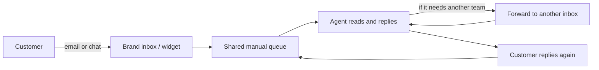

# 02 — Current-state journeys and gaps

## 1. Where things stand

Each brand runs the same shape of process, separately:

All enquiries — a password reset and a cancellation threat — arrive in the same
queue and are triaged by eye.

## 2. Journey map (single enquiry)

| Stage | What the customer does | What the business does | Friction |
|---|---|---|---|
| Discover | looks for a way to get help | exposes an inbox and a widget | email and chat are handled by different people |
| Ask | writes free text | someone reads it eventually | no acknowledgement; the customer does not know if it landed |
| Wait | waits | triage by eye, worst case first | a routine question waits behind a complaint |
| Answer | reads the reply | writes from scratch | tone and accuracy vary by agent and brand |
| Chase | replies again with more detail | re-reads the thread | context is re-explained; emails carry the whole quoted history |
| Resolve / abandon | goes quiet or leaves | closes it | no record of why it failed |

## 3. Gaps and root causes

| Gap | Root cause |
|---|---|
| No automation of routine questions | no intent taxonomy; each enquiry is bespoke work |
| Inconsistent answers across brands | policies live in people's heads, not configuration |
| Sensitive and trivial work share a queue | no classification; triage is manual and error-prone |
| Handoffs lose context | agents re-read whole threads; email quoting is unstructured |
| Varying response times | no per-brand, per-urgency SLA
| Cannot measure | no structured decision record |

## 4. What success looks like

A routine billing question is answered in seconds in the brand's voice; a
cancellation is routed to retention with a one-line summary and an SLA; a
furious customer reaches a person immediately. Every one of those outcomes is
logged with the reason it happened, so the team can tune policy from evidence
rather than anecdote.

## 5. Opportunity sizing (illustrative)

If routine enquiries (billing, account, simple technical) are ~55% of volume,
and the AI can safely own ~70% of those, that is a ~38% deflection — which is
the headroom that matters for the business case, without touching the sensitive
20% that must stay human.
