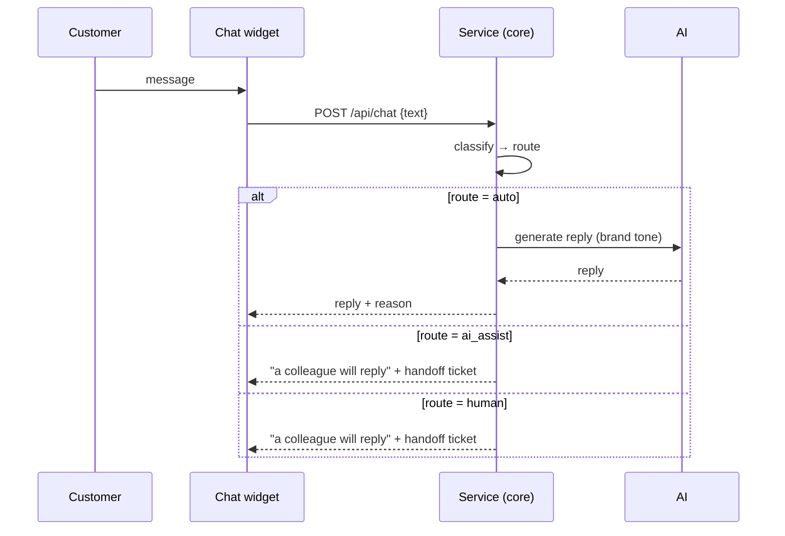
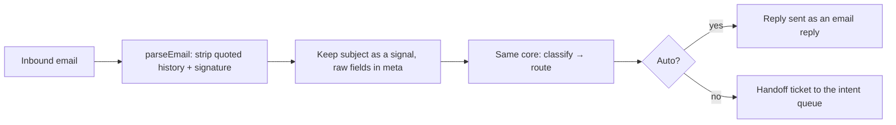
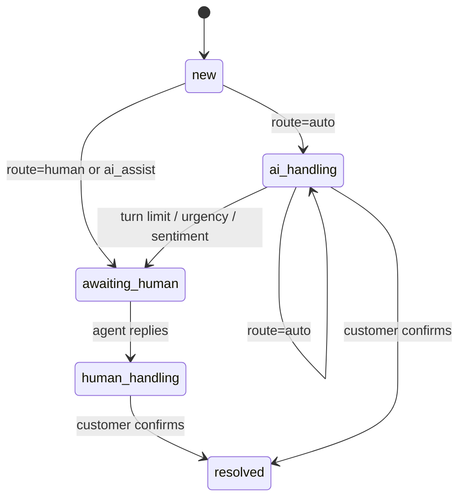

# 03 — Conversation flows

Two channels, one core. The channel decides how a message is parsed and
rendered; the core decides what happens to it.

## 1. Intent taxonomy

Deliberately small and operational — each intent maps to a queue and a policy.

| Intent | Example cues | Default queue suffix |
|---|---|---|
| `billing` | invoice, charged, refund, overcharged | `-billing` |
| `technical` | error, down, 500, DNS, can't log in | `-technical` |
| `cancellation` | cancel, terminate, not renewing | `-retention` |
| `sales` | pricing, upgrade, demo, quote | `-sales` |
| `complaint` | unacceptable, escalate, ombudsman | `-escalations` |
| `account` | password, reset, 2FA, permissions | `-account` |
| `other` | everything else | `-general` |

## 2. Chat flow

## 3. Email flow

The only email-specific logic is `stripQuoted` — removing quoted history and
signatures so the classifier sees the new content. Everything downstream is
shared with chat.

## 4. Conversation state machine

Only one handoff ticket is ever raised per conversation: once a human owns it,
later messages do not create new tickets (see `handleInbound` in
`src/core/conversation.ts`).

## 5. Design decisions

- **Chat and email share one core.** A new channel adds an adapter, not a
  parallel policy.
- **The AI replies only after routing says it may.** The model never decides
  whether it is allowed to answer.
- **Unsummarised context is never cut.** Unlike a compaction strategy, a
  handoff carries the real thread; the one-line summary is for triage only.
- **No sensitive data in the AI path.** The system prompt forbids requesting
  credentials; this is written down so it can be tested and audited.
