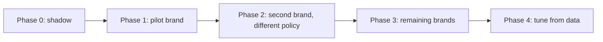

# 07 — Multi-brand rollout

## 1. What is shared, what is per brand

| Shared (the core) | Per brand (configuration) |
|---|---|
| intent taxonomy | `humanIntents` — which intents never auto-resolve |
| classification and routing rules | `confidenceFloor` — automation tolerance |
| handoff ticket shape | `maxAiTurns` — escalation limit |
| channel adapters | `queues` — where handoffs land |
| conversation state machine | `sla` — response targets |
| safety rules | `tone` — voice for generated replies |

This split is the whole point: **standardise the machinery, localise the
policy**. Without it, five brands means five implementations and five sets of
bugs.

## 2. Why per-brand policy is needed

Brands differ in ways that are commercial, not technical:

- A hosting brand treats *cancellation* as a retention event — human, always.
- A self-serve tools brand is happy for the AI to discuss pricing.
- Queues and SLAs follow each brand's team structure, not ours.

None of that should require a code change, so none of it does.

## 3. Rollout phases

| Phase | What ships | Exit criteria |
|---|---|---|
| 0 | AI drafts, humans send everything (no auto) | drafts judged useful; no misroutes |
| 1 | `auto` enabled on the safest intents, one brand | auto-resolution rate and CSAT hold up |
| 2 | a second brand with a *different* policy | config-only difference proven in production |
| 3 | remaining brands onboarded from the config template | onboarding is configuration, not code |
| 4 | policy tuned from transcripts | intents and thresholds refined from evidence |

Phase 0 is the important one: it earns trust before the AI replies without a
human, and it needs no new capability — set `confidenceFloor` above 1 so
everything becomes `ai_assist`.

## 4. Risks and mitigations

| Risk | Mitigation |
|---|---|
| One brand's policy leaks into another | policy is per-brand config, reviewed with the brand owner |
| Over-automation of sensitive topics | `humanIntents` is a hard rule, tested, not a model judgement |
| Inconsistent tone | tone is configuration; replies are structurally reviewed |
| Escalation flood | SLAs per urgency; turn limit is per brand |
| Silent model failure | offline fallback returns a safe template, never silence |

## 5. Onboarding checklist for a new brand

1. Copy the config template; set `tone`, `humanIntents`, `confidenceFloor`,
   `maxAiTurns`, `queues`, `sla`.
2. Confirm the queue names exist in the contact-centre tool.
3. Run the automated suite against the new config (it is data, so it runs as-is).
4. Shadow mode for two weeks; review every handoff and a sample of `auto`.
5. Enable `auto` intent by intent, not all at once.
